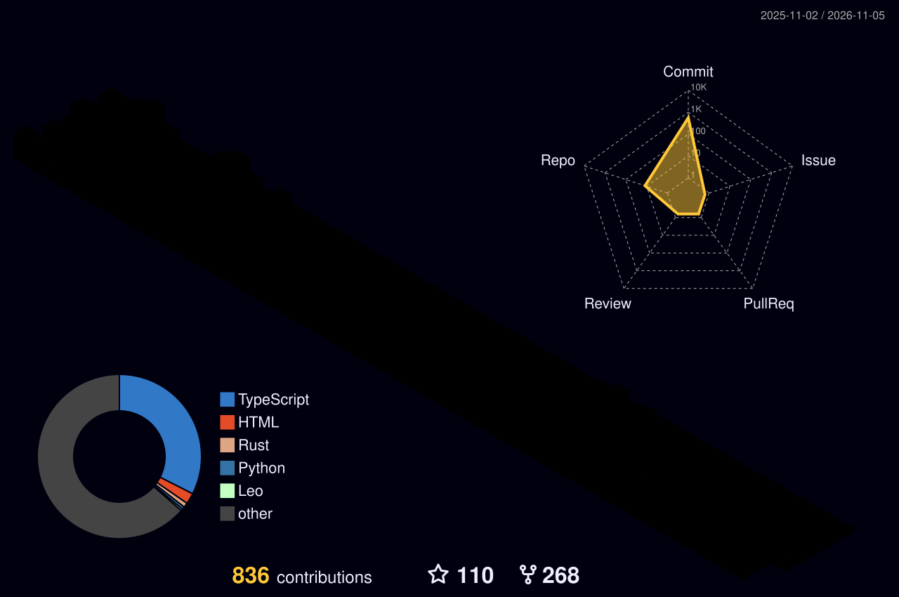

  

  <h1 align="center">👋 Hi there, I'm Chinmay Patil</h1>
  
  

  

    
    
    
    
    
  

---

### 👨‍💻 About Me

I am a **Computer Science Engineer** and **Tech Entrepreneur** based in **Mainz, Germany**. My work sits at the intersection of **product engineering**, **Artificial Intelligence**, and **software systems**.

- 🚀 **Background:** Co-founded **Anthé Labs** (2025–2026), working across product and full-stack engineering.
- 🔭 **Focus:** Building and shipping real products — from AI tools to full-stack apps.
- ⚡ **Tech:** Focused on **Next.js**, **TypeScript**, **Node.js**, and modern web/APIs.
- 🎓 **Now:** M.Sc. Computer Science at **TH Bingen**.

---

### 🛠️ Tech Stack

| **Frontend** | **Backend** | **Blockchain** | **Tools** |
| :---: | :---: | :---: | :---: |
|  |  |  |  |

---

### 📊 GitHub Stats & Contributions

  <table>
    <tr>
      <td>
        
      </td>
      <td>
        
      </td>
    </tr>
  </table>

   
  

---
### 🧱 My 3D Contributions

  

  <i>"The best way to predict the future is to invent it."</i>

